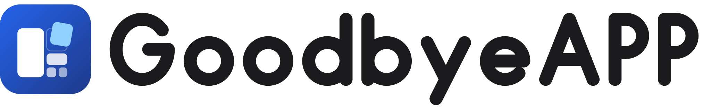

<p align="center">
  
</p>

<p align="center"><b>Remove apps. Reclaim space.</b></p>

<p align="center">
  Uygulamaları kaldıran, geride kalan dosya ve kayıt defteri kalıntılarını temizleyen ve diskte en çok yer kaplayan dosyaları bulan açık kaynaklı masaüstü uygulaması.
</p>

---

## Özellikler

- **Uygulama listesi:** Bilgisayarda kurulu uygulamalar logoları, yayıncıları ve kapladıkları alanla birlikte tek listede görünür. Ada göre aranabilir, boyuta göre sıralanabilir.
- **Adım adım kaldırma:** Uygulamanın kendi kaldırıcısı çalıştırılır, ardından geride kalanlar taranır. Neyin silineceğine siz karar verirsiniz; hiçbir şey otomatik seçilmez.
- **Kalıntı temizliği:** Kayıt defteri anahtarları, AppData / ProgramData / Temp klasörleri, kurulum klasörü, Başlat menüsü ve masaüstü kısayolları bulunur.
- **Güvenli silme:** Kayıt defteri anahtarları silinmeden önce `.reg` dosyası olarak yedeklenir. İsterseniz kaldırmadan önce Windows sistem geri yükleme noktası oluşturulur.
- **Yönetici olarak yeniden deneme:** Yetki gerektiren kalıntılar tek bir UAC onayıyla yeniden denenir.
- **Büyük dosyalar:** Her diskte en çok yer kaplayan dosyalar listelenir ve tek tıkla klasörde gösterilir. NTFS disklerde dosya tablosu (MFT) doğrudan okunduğu için tarama saniyeler sürer.
- **Hızlı arama:** Tek bir arama kutusundan uygulamalara, büyük dosyalara ve ayarlara ulaşılır.
- **Görünüm:** Açık, koyu ve sistem teması; sekiz vurgu rengi (Mavi, Mor, Turkuaz, Yeşil, Kehribar, Turuncu, Pembe, Grafit); varsayılan renk mavidir. Azaltılmış hareket tercihine uyulur.
- **Türkçe ve İngilizce:** Uygulama işletim sisteminin dilini kullanır; sistem dili Türkçe değilse İngilizce açılır. Dil, Ayarlar'dan elle değiştirilebilir.
- **Gizlilik:** Uygulama internete veri göndermez. Logolar bile internetten indirilmez, sistemdeki kayıtlı simgelerden okunur.

## Kurulum

### Hazır kurulum dosyası (Windows)

1. [Releases](https://github.com/erdewave/goodbyeapp/releases) sayfasından `GoodbyeAPP-Setup-<sürüm>.exe` dosyasını indirin.
2. Dosyayı çalıştırın. Kurulum tek adımlıdır ve uygulama kullanıcı klasörüne kurulur.
3. GoodbyeAPP'i Başlat menüsünden açın. Kayıt defteri ve Program Files kalıntılarını temizleyebilmesi için açılışta yönetici izni ister.

> Kurulum dosyası dijital olarak imzalı değildir. Windows SmartScreen uyarı gösterirse **Ek bilgi → Yine de çalıştır** seçeneğini kullanın.

### Kaynak koddan

Gereksinim: [Node.js](https://nodejs.org) 22.18 veya üzeri.

```sh
git clone https://github.com/erdewave/goodbyeapp.git
cd goodbyeapp
npm install
npm start
```

Kendi kurulum dosyanızı üretmek için:

```sh
npm run dist
```

Çıktı `release/` klasörüne yazılır: Windows'ta NSIS kurulumu, macOS'ta DMG, Linux'ta AppImage ve deb. Her paketi kendi işletim sisteminde derleyin.

## Kullanım

### Bir uygulamayı kaldırmak

**Uygulamalar** sekmesinde kaldırmak istediğiniz uygulamanın yanındaki **Kaldır** düğmesine basın. Dört adımlı sihirbaz açılır:

1. **Kaldır:** Uygulamanın kendi kaldırıcısı çalışır. Kaldırma doğrulandıktan sonra kalıntılar taranır.
2. **Kayıt defteri:** Uygulama veya yayıncı adıyla eşleşen anahtarlar listelenir. Tek tek ya da **Tümünü seç** ile işaretleyin.
3. **Disk:** Kurulum klasörü, AppData, ProgramData, Temp ve kısayollardaki kalıntılar listelenir. Aynı şekilde seçin.
4. **Bitti:** **Seçilenleri temizle** ile işaretlenenler silinir. Silinemeyen öğeler nedeniyle birlikte gösterilir; **Yönetici olarak dene** ile yeniden denenebilir.

Aynı anda birden fazla kaldırma başlatabilirsiniz; işler sıraya alınır ve ilerlemeleri bildirim olarak görünür.

### Büyük dosyaları bulmak

**Büyük dosyalar** sekmesini açın. Tarama otomatik başlar ve her disk için en büyük dosyalar boyut sırasıyla listelenir. Bir dosyanın yanındaki klasör simgesi onu Dosya Gezgini'nde açar. Taramayı **Durdur** ile kesebilir, **Yeniden tara** ile tekrarlayabilirsiniz.

### Ayarlar

- **Görünüm** ve **Uygulama rengi:** Tema ve vurgu rengini seçin.
- **Dil:** Sistem dili, Türkçe veya English arasında seçim yapın.
- **Kaldırmadan önce geri yükleme noktası:** Açıksa her kaldırmadan önce Windows geri yükleme noktası oluşturulur. Windows son 24 saatte oluşturulmuş bir nokta varsa yenisini atlar.
- **Yedek klasörünü aç:** Silinen kayıt defteri anahtarlarının `.reg` yedeklerine ulaşın. Bir anahtarı geri getirmek için ilgili dosyaya çift tıklamanız yeterli.

## Platform desteği

| Platform | Kaldırma | Kalıntı taraması |
| --- | --- | --- |
| Windows | HKLM / HKCU kaldırma kayıtlarındaki Win32 uygulamaları (EXE ve MSI) | Kayıt defteri (WOW6432Node dahil), Program Files, AppData, ProgramData, Temp, Başlat menüsü ve masaüstü kısayolları |
| macOS | `/Applications` ve `~/Applications` içindeki `.app` paketleri, çöp kutusuna taşınır | Kullanıcı Library altındaki Application Support, Caches, Preferences, Logs, Saved Application State |
| Linux | Kullanıcı ve sistem Flatpak uygulamaları | XDG config, cache, data ve `~/.var/app` |

Uygulama Windows üzerinde geliştirilip test edilmiştir. macOS ve Linux kodları bu sistemlerde ayrıca doğrulanmamıştır.

Desteklenmeyenler: Microsoft Store uygulamaları, apt / rpm / Snap paketleri, servisler, sürücüler ve paylaşılan çalışma zamanları.

## Bilinmesi gerekenler

- Kalıntılar ada göre eşleştirilir; bu, bir dosyanın o uygulamaya ait olduğunu kesin olarak kanıtlamaz. Silmeden önce listeyi gözden geçirin.
- Silinen kalıntı dosyaları geri dönüşüm kutusuna gitmez, kalıcı olarak silinir. Kayıt defteri anahtarlarının yedeği alınır.
- Kaldırılan uygulamanın kendisi geri yüklenmez; gerekirse yeniden kurulmalıdır.
- Çok büyük klasörlerin boyutu yaklaşık gösterilir. Boyutu bilinmeyen uygulamalarda "—" görünür.

## Güvenlik

- Arayüz, Node.js erişimi olmadan sandbox ve context isolation ile çalışır.
- Temizlik istekleri arayüzden dosya yolu almaz; ana süreçte üretilmiş tarama planındaki kimlikleri kullanır.
- Her yol silinmeden hemen önce yeniden doğrulanır. Kök dizinler ve sembolik bağlantılar reddedilir, bağlantı noktaları takip edilmez.
- Kayıt defteri yedeği alınamazsa anahtar silinmez.

## Geliştirme

TypeScript, Electron, React 19, Vite ve Tailwind CSS; arayüz bileşenleri [beUI](https://beui.dev) tabanlıdır.

| Komut | Ne yapar |
| --- | --- |
| `npm start` | Derler ve uygulamayı açar |
| `npm run build` | Tip kontrolü yapar, arayüzü `dist-ui`, ana süreci `dist-electron` içine derler |
| `npm test` | Birim testlerini çalıştırır (yalnızca geçici test klasörlerinde, gerçek uygulama kaldırmaz) |
| `npm run test:ui` | Electron arayüz testini çalıştırır |
| `npm run pack` | Kurulum dosyası olmadan paketler |
| `npm run dist` | Kurulum dosyasını üretir |

Klasörler: `electron/` ana süreç ve sistem işlemleri, `ui/` arayüz, `tests/` testler, `assets/brand/` logo ve ikonlar ([marka rehberi](assets/brand/BRAND.md)).

## Lisans

[MIT](LICENSE)
